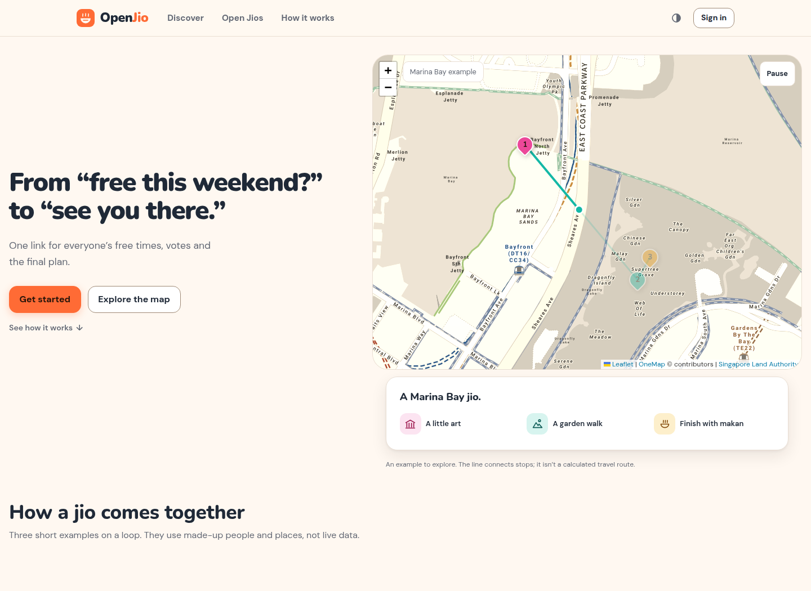
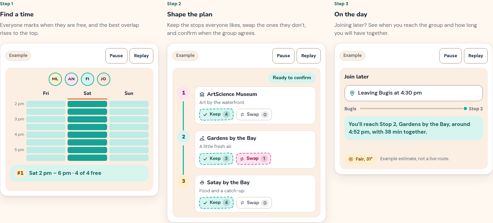
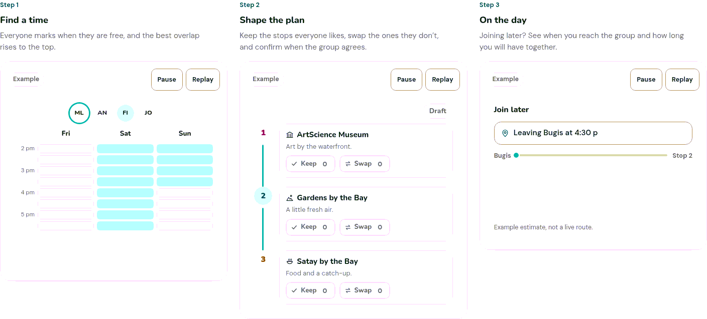

# OpenJio

**Plan a Singapore outing together.** Find a time that works, agree on stops, and share one clear plan with everyone.

OpenJio helps a group go from *“free this weekend?”* to *“see you there.”* Everyone gets one link for availability, votes, and the final itinerary.
The current UI is designed for desktop use.



## How it works

1. **Find a time:** everyone marks when they are free; the best overlap rises to the top.
2. **Shape the plan:** review the stops, vote to keep or swap them, and confirm the group plan.
3. **Meet up:** share the itinerary, with an estimate to help late joiners catch up.

The examples below are clearly labelled illustrations using made-up people and places. They are separate from live listings.



<details>
<summary>Watch the examples animate</summary>



</details>

## Tech stack

<p>
  <a href="https://vuejs.org/"></a>
  <a href="https://vite.dev/"></a>
  <a href="https://getbootstrap.com/"></a>
  <a href="https://leafletjs.com/"></a>
  <a href="https://nodejs.org/"></a>
  <a href="https://expressjs.com/"></a>
  <a href="https://supabase.com/"></a>
  <a href="https://www.postgresql.org/"></a>
  <a href="https://www.python.org/"></a>
  <a href="https://www.docker.com/"></a>
</p>

OneMap/Singapore Land Authority supplies maps, address lookup and routes. Geoapify supplies OpenStreetMap places, and NEA/data.gov.sg supplies weather.

## Choose the right installation

This is the **`main` branch**: real accounts and live provider data, with no seeded users, outings or sample listings. OpenJio is an independent personal project; keep service and hosting costs at **$0** using existing hardware.

| Branch | Data and accounts | Fresh-install URL | Setup |
|---|---|---|---|
| `main` | Accounts you create; real provider listings; initially empty | `http://localhost:8080` | Commands below |
| `demo` | Six real demo accounts, five outings, 70 labelled sample listings, relative-date reset | `http://127.0.0.1:8082` | [Demo branch guide](https://github.com/asurazxz/OpenJio/blob/demo/docs/DEMO.md) |

Changing Git branches does **not** switch, copy or reset a database. Containers continue serving their built images until rebuilt. Use separate clones if running both installations; one stack is enough for routine use.

## Host live data from a fresh clone

Requirements: Git and Docker Engine/Desktop with **Compose 2.24+**. Start Docker and ensure your user can run `docker compose`. First build requires internet. Host Node, Python, pnpm and a managed Supabase project are unnecessary for this Docker setup.

```bash
git clone --branch main https://github.com/asurazxz/OpenJio.git OpenJio-live
cd OpenJio-live
cp .env.example .env
docker compose run --rm setup
docker compose --env-file .env.docker up --build -d --wait
```

On PowerShell use `Copy-Item .env.example .env`. Copy the example only on first setup. The setup tool generates private `.env.docker` credentials once and preserves them on reruns. Keep that file with the database volumes; never commit it.

Open **http://localhost:8080** and create your own account. There are **no default live login credentials**. Separate browser profiles/devices can sign in independently and share an outing via its invite link. Local signup auto-confirms email.

**Discover starts empty.** To populate it, add your own Geoapify/OneMap configuration to `.env`, recreate the API, and ingest current posts:

```bash
docker compose --env-file .env.docker up -d api
docker compose --env-file .env.docker exec api node /app/scripts/run-ingest.mjs
```

Venue refresh and post extraction are asynchronous; inspect `/api/places/catalogue/status`, `/api/ingest/status` and API logs before refreshing Discover. Gemini/Telegram login are optional. See [provider setup and live data](docs/DEVELOPMENT.md#live-data-empty-first-then-provider-input) for exact requirements, imports and scheduled ingestion. Missing provider data never falls back to fabricated listings.

A fresh checkout reproduces the **hosting**, not this machine's private accounts or changing catalogue snapshot. For an exact authorized data transfer, use [backup and restore](docs/OPERATIONS.md#backup-and-restore).

## Operate the installation

```bash
docker compose --env-file .env.docker ps
docker compose --env-file .env.docker logs --tail=100 api migrate
docker compose --env-file .env.docker stop
docker compose --env-file .env.docker up -d --wait
```

These commands retain data. `down` also retains named volumes; **`down -v` permanently deletes them**. The stack needs six running services: web, API, internal Supabase gateway, REST, Auth and PostgreSQL. Setup/migrations are one-shot jobs. [Container roles, backups and upgrades](docs/OPERATIONS.md).

For LAN hosting, change `APP_BIND`, `APP_PORT` and matching `APP_URL` together in `.env.docker`, preserving its secrets, then recreate the stack. [Detailed LAN instructions](docs/DEVELOPMENT.md#lan-hosting-and-current-server). This local recipe does not configure public HTTPS or email recovery.

This server uses **http://192.168.1.100:8081** for live OpenJio because Nextcloud occupies LAN port 8080. The live stack was stopped at the user's request on 3 November 2026, retaining volumes. Its independent demo runs on **8082**. These machine-specific addresses are not fresh-install defaults.

## Develop and verify

For hot reload, install Node **22.12+** and pnpm **12.16.1** while Docker is running:

```bash
pnpm --dir client install --frozen-lockfile
pnpm --dir server install --frozen-lockfile
pnpm --dir client dev
```

Open Vite's printed URL, normally http://localhost:5173. Set root `.env`'s `OPENJIO_DOCKER_URL` if Docker uses another address/port, then restart Vite. Vite forwards config/Auth/API requests; no second host API process is needed.

```bash
pnpm --dir client test
pnpm --dir server test
node --test scripts/tests/*.test.mjs
pnpm --dir client build
```

[Verification details](docs/DEVELOPMENT.md#verification) cover browser/SQL checks, dependency installation, historical fixture tests and disposable shared-account tests. Tests that create accounts/outings require explicit write opt-in and a separate test database. `VITE_DATA_MODE=demo` is an older browser-local fixture mode, not the seeded database deployment on branch `demo`.

## Documentation

| Guide | Contents |
|---|---|
| [Development](docs/DEVELOPMENT.md) | Fresh live setup, provider credentials, ingestion/imports, LAN, hot reload and tests |
| [Operations](docs/OPERATIONS.md) | Ports, containers, persistence, backups, restore and upgrades |
| [Architecture](docs/ARCHITECTURE.md) | Auth/API/database boundaries, permissions, algorithms and design |
| [Project](docs/PROJECT.md) | Product behavior, $0 policy, limitations and roadmap |
| [Hosting verification](docs/HOSTING-VERIFICATION.md) | Dated fresh-install, browser and backup/restore checks |
| [Evaluation](docs/EVALUATION.md) | Synthetic algorithm comparisons; not a live-provider benchmark |
| [Demo branch](https://github.com/asurazxz/OpenJio/blob/demo/README.md) | Separate seeded installation, six accounts and a reset two weeks ahead |

## Sources and credits

Fonts: Nunito and DM Sans. Deals and events retain links to their public Telegram/confirmgood sources; preserve provider attribution. Landing illustrations and synthetic algorithm fixtures are labelled examples, separate from the live catalogue.
